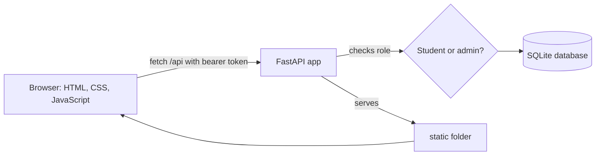

# CampusConnect: Report Anything on Campus

### Spot it. Report it. Get it fixed.

**A full-stack web app where students report campus issues, track their status and message the admin. Admins see everything, sort by category, update statuses and leave notes.**


[Features](#what-you-can-do) · [Roles](#two-roles-one-platform) · [Quick start](#quick-start) · [How it works](#how-it-works) · [API](#api-reference) · [Status](#current-status) · [FAQ](#faq) · [Team](#team-members)

```
uvicorn main:app --reload
```

<!-- Add a screenshot of the landing page or dashboard here, for example: -->
<!--  -->

---

Problems around campus, such as a broken projector, a Wi-Fi outage or a lost ID card, are often reported informally and then forgotten. CampusConnect gives students one simple place to report them and follow each report from **Open** to **In Progress** to **Resolved**, while giving the admin a single view of everything that has been raised.

Built for **Code2Chill Weekly Project 01** with HTML, CSS and JavaScript on the front end, Python and FastAPI on the back end, and SQLite for storage. The goal is a small project that works properly, not a large one.

## What you can do

| Report | Track | Respond |
|---|---|---|
| Create an issue with a title, description and category | See live Open / In Progress / Resolved counts on your dashboard | Admin updates the status and leaves notes you can read on the issue |
| Pick from Classroom, Campus, Lost & Found or General | Open any issue to see its details and history | Chat with the admin from the Messages page |
| Read the FAQ for common campus problems | Filter your issues by status | An unread counter in the menu shows new messages |

## Two roles, one platform

| | Student | Admin |
|---|---|---|
| Register and log in | Yes | Seeded automatically |
| Create issues | Yes | No (review role) |
| See issues | Only their own | Every issue |
| Filter by status | Yes | Yes |
| Filter and sort by category | No | Yes |
| Change an issue's status | No | **Yes, only the admin** |
| Leave notes on an issue | No | Yes, visible to the reporting student |
| Read notes on their issue | Yes | Yes |
| Messaging | One chat with the admin | Inbox of all student chats, or start one from an issue |
| FAQ and landing page | Yes | Yes |

These rules are enforced by the server, not just hidden in the interface. A student who opens another student's issue link gets "doesn't exist", and a status change from a student account is rejected.

## Quick start

Requires **Python 3.10 or newer**.

### 1. Set up

Open a terminal in the project folder (the one containing `main.py`).

Windows (PowerShell):

```
python -m venv .venv
.venv\Scripts\Activate.ps1
pip install -r requirements.txt
```

macOS / Linux:

```
python3 -m venv .venv
source .venv/bin/activate
pip install -r requirements.txt
```

If PowerShell blocks the activation script, run `Set-ExecutionPolicy -Scope CurrentUser RemoteSigned` once and try again.

### 2. Run

```
uvicorn main:app --reload
```

Open http://127.0.0.1:8000/ to see the landing page. The SQLite database (`campusconnect.db`) is created automatically on first run.

Do not serve the `static` folder with `python -m http.server`. The app needs the FastAPI backend for its `/api` routes.

### 3. Log in as the admin

An admin account is created on first start:

| | |
|---|---|
| Email | `admin@campusconnect.com` |
| Password | `admin123` |

To use your own credentials, set environment variables **before the first run**.

Windows (PowerShell):

```
$env:ADMIN_EMAIL="you@college.edu"
$env:ADMIN_PASSWORD="a-strong-password"
uvicorn main:app --reload
```

macOS / Linux:

```
ADMIN_EMAIL=you@college.edu ADMIN_PASSWORD=a-strong-password uvicorn main:app --reload
```

Everyone who registers through the website is a student account. Change the default admin password before hosting this anywhere public.

## One report, start to finish

| Step | Who | What happens |
|---|---|---|
| 1 | Student | Registers and logs in |
| 2 | Student | Creates an issue: title, description, category |
| 3 | Admin | Sees it on the admin dashboard and filters or sorts by category |
| 4 | Admin | Moves it from **Open** to **In Progress** and leaves a note |
| 5 | Student | Sees the new status and the note on the issue page, and gets a message counter in the menu if the admin writes |
| 6 | Admin | Marks it **Resolved** |

## How it works



- The **frontend** is plain HTML pages in `static/` that call the API with `fetch`.
- The **backend** is a single FastAPI app (`main.py`) that validates input with Pydantic and also serves the `static` folder.
- The **database** has five tables: `users`, `sessions`, `issues`, `issue_notes` and `messages`. Older databases are migrated automatically on startup.
- **Security:** passwords are hashed with PBKDF2-SHA256, sessions use random bearer tokens, and every API route checks who is asking and what their role allows.

## Project structure

```
campusconnect/
├── main.py             # FastAPI app and API routes
├── database.py         # SQLite setup, migrations, admin seeding, password hashing
├── requirements.txt
└── static/             # Frontend
    ├── landing.html    # Landing page
    ├── index.html      # Login / register
    ├── dashboard.html  # Student and admin dashboards
    ├── create.html     # Create an issue
    ├── issue.html      # Issue details, notes, status
    ├── messages.html   # Messaging
    ├── faq.html        # FAQ
    ├── profile.html    # Profile and logout
    ├── css/            # style.css, landing.css
    └── js/             # app.js (shared helpers and navigation)
```

## API reference

All routes are under `/api`. Everything except register and login needs an `Authorization: Bearer <token>` header.

| Area | Route | Who |
|---|---|---|
| Account | `POST /register`, `POST /login`, `POST /logout`, `GET /me` | Anyone / logged in |
| Issues | `GET /issues` (own issues, or all for admin; `?category=` filter) | Logged in |
| | `POST /issues`, `GET /issues/{id}` | Logged in (own issues) / admin (any) |
| | `PATCH /issues/{id}/status` | **Admin only** |
| | `POST /issues/{id}/notes` | **Admin only** |
| Messages | `GET /messages`, `POST /messages` | Student |
| | `GET /messages/conversations`, `GET` and `POST /messages/conversations/{student_id}` | **Admin only** |
| | `GET /messages/unread` | Logged in |

Interactive API docs are available at http://127.0.0.1:8000/docs while the server is running.

## Current status

- **Working:** registration and login, issue creation, student and admin dashboards, category filtering and sorting, admin-only status changes, admin notes, student and admin messaging, FAQ, landing page.
- **Not built yet:** password reset, editing or deleting an issue, email notifications, live (push) message updates. The Messages page refreshes every 10 seconds instead.
- **Not in scope:** this is a learning project. It has not been hardened for production use.

## FAQ

**Why does the page show a server error when I use `python -m http.server`?**
That command only serves static files. The app's `/api` routes need the FastAPI backend, so run `uvicorn main:app --reload` instead.

**I forgot the admin password. What do I do?**
Delete `campusconnect.db` (this erases all data) and start the server again with the `ADMIN_EMAIL` and `ADMIN_PASSWORD` you want.

**Can a student see another student's issues?**
No. Students only see their own issues. Only the admin sees all of them.

**Why can't students change an issue's status?**
So that everyone sees the same, trusted progress. Only the admin updates the status, and students can message the admin if they think it is wrong.

**Is this safe for real use?**
It follows sensible basics (hashed passwords, role checks on the server), but it is a student learning project and has not been security-reviewed. Change the default admin password and review it before any public deployment.

## Development

The team follows the standard GitHub workflow from the project guidelines:

```
Branch -> Commit -> Push -> Pull Request -> Merge
```

Every member contributes through their own branches and pull requests. Do not commit `.venv/`, `__pycache__/` or `campusconnect.db`. They are already listed in `.gitignore`.

## Team Members

| Name | Role / Contribution |
|---|---|
| _Your Name_ | _e.g. Backend and database_ |
| _Teammate 2_ | _e.g. Frontend pages_ |
| _Teammate 3_ | _e.g. Dashboard and admin features_ |

---

[Features](#what-you-can-do) · [Quick start](#quick-start) · [How it works](#how-it-works) · [API](#api-reference) · [FAQ](#faq) · [Team](#team-members)
